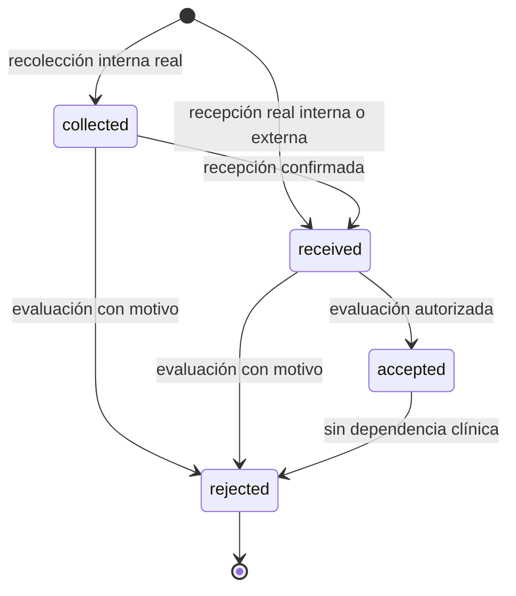

# BE-S2-05 — Gestión de muestras físicas y avance operativo individual

**Estado:** implementado y validado con PostgreSQL aislado el **2026-10-11**. No se ejecutaron migraciones ni seeders en desarrollo o producción. No hay commits, push, cambios de frontend ni cierre de Trello.

## 1. Auditoría y relación con BE-S2-04

Se inspeccionaron migraciones, modelos, acciones de composición/estado/eliminación, documentos publicados, middleware SaaS/Teams, auditoría, OpenAPI, pruebas de concurrencia y procedencia demo antes de modificar código. BE-S2-04 ya materializa requisitos separados por línea y fija una versión publicada; no contiene muestras físicas ni información suficiente para evaluar aditivos, conservación y tiempos. `clinical_activity_started_at` protege historia desde la primera asociación; no equivale a iniciar procesamiento.

Se reutilizan `ClinicalExamService`, `AuditWriter`, `TransitionLaboratoryOrderStatus`, `CurrentLaboratory`, `BelongsToLaboratory`, Spatie Teams y `DemoDataset`. Se conservan la composición atómica, precios/descuentos, snapshots inmutables y corte legacy cerrado. Una nueva migración añade estructuras; no genera muestras, asociaciones, versiones, actividad ni backfill histórico.

Las fases implementadas fueron auditoría, persistencia, registro, compatibilidad/asociación, evaluación/corrección, preparación/inicio, consulta consolidada y demo/documentación. Cada etapa se contrastó con pruebas PostgreSQL. Las funcionalidades verificadas y pendientes se enumeran al final.

## 2. Persistencia y fuente de verdad

Migración: `laravel/database/migrations/2026_10_10_000004_add_physical_sample_operations.php`, posterior a las migraciones de configuración, composición y registro demo.

| Estructura | Función |
| --- | --- |
| `laboratory_samples` | Muestra real; ULID único e inmutable, laboratorio/orden/tipo, procedencia, estado, recolección y recepción independientes, hechos observados JSONB. |
| `laboratory_sample_events` | Historia append-only: hecho, usuario que lo registró, fecha efectiva, fecha de registro y contexto permitido. |
| `laboratory_sample_associations` | Muchos a muchos; identidad por asociación, actor/fecha, liberación con actor/fecha/motivo; nunca se borra evidencia. Índice único parcial para cada par activo. |
| `laboratory_sample_processing_dependencies` | Asociaciones efectivamente utilizadas al iniciar cada línea; snapshot de requisito, versión, hechos de muestra y fecha de evaluación. Inmutable. |
| `laboratory_sample_idempotencies` | Clave por laboratorio, digest del payload normalizado, orden/muestra y primera respuesta JSON persistida. |
| `laboratory_sample_requirement_satisfactions` | **Vista calculada**, sin escrituras: requisito satisfecho si existe una asociación activa con una muestra aceptada que cumple su configuración histórica en ese momento. |
| `laboratory_order_exams` | Añade `processing_started_at` y `processing_started_by`; una vez fijados no pueden borrarse ni sustituirse. |

La fuente de verdad es la asociación activa, el estado físico y la función PostgreSQL `sample_compatibility_errors`, aplicada sobre el snapshot de requisito y la versión fijada en su línea. `sample_operation_time()` usa el tiempo de la sentencia PostgreSQL; no se congela al comenzar una transacción ni depende del reloj enviado por clientes. Las condiciones temporales pueden hacer que un requisito vuelva a pendiente sin ninguna escritura.

El CHECK anterior de requisitos se amplía deliberadamente a `pending|satisfied`. **La columna persistida `laboratory_order_sample_requirements.status` se conserva como dato de compatibilidad de BE-S2-04, no como caché clínica:** esta entrega no la actualiza. Los requisitos existentes conservan `pending`. Las lecturas HTTP de líneas exponen el estado derivado mediante la vista y la consulta consolidada evalúa la misma función. Consultas SQL de operación deben usar la vista; leer solamente la columna antigua no determina preparación clínica. La vista y su modelo rechazan escrituras.

Las FK compuestas obligan a que muestra, orden, requisito, asociación y dependencia pertenezcan al mismo laboratorio y orden. La dependencia también verifica que el requisito corresponda exactamente a su línea. Los tipos y sucursales tienen FK al catálogo local. Los triggers protegen identidad, transición, hechos conocidos, recepción, eventos, asociaciones, dependencias, respuesta de idempotencia e inicio. La publicación y los snapshots de BE-S2-03/04 permanecen inmutables.

El down elimina toda la historia física nueva y las columnas de inicio. Solo es apropiado antes de utilizar el módulo o con un procedimiento explícito de respaldo/restauración; no reconstruye historia eliminada. Las funciones usan `CREATE OR REPLACE` para soportar `migrate:fresh`. La protección y evaluación descritas requieren PostgreSQL; no se promete equivalencia SQLite.

## 3. Servicios, modelos y permisos

`LaboratorySampleService` centraliza transacciones, trazabilidad, estados, idempotencia, asociaciones, correcciones e inicio. `SampleCompatibility` consulta el evaluador PostgreSQL para candidatos, satisfacción y decisiones de inicio. `LaboratorySampleController`, `LaboratorySampleRequest` y `LaboratorySampleResource` seleccionan explícitamente contratos y campos; no aceptan identificadores, estados, actores de recepción ni marcadores arbitrarios enviados por clientes.

Modelos nuevos: `LaboratorySample`, `LaboratorySampleEvent`, `LaboratorySampleAssociation`, `LaboratorySampleProcessingDependency` y el modelo de vista `LaboratorySampleRequirementSatisfaction`. Los modelos de línea y requisito incorporan inicio y satisfacción operativa. Las fechas de muestras, eventos y asociaciones conservan microsegundos, incluidos reintentos de recepción.

Se añaden seis permisos: `samples.view`, `samples.collect`, `samples.receive`, `samples.evaluate`, `samples.associate` y `orders.start_exam`. Total: **51 permisos y los seis roles existentes**. Owner/administrator reciben los nuevos permisos en el catálogo; los demás roles conservan sus privilegios anteriores. Recepción no concede aceptación ni asociación. `RolePermissionSeeder` conserva su contrato independiente; no se modifica su implementación.

Todas las rutas reutilizan Sanctum, usuario activo, `X-Laboratory-ID`, membresía activa, contexto Teams y suscripción. La consulta consolidada exige además `orders.view`, porque expone la cabecera existente. Las mutaciones del servicio comprueban actor/membresía/contexto Teams y permiso, también cuando se invocan desde CLI; la API conserva el middleware de suscripción. Los objetos ajenos o inexistentes devuelven 404 sin revelar información de otro laboratorio.

## 4. Máquina de estados y trazabilidad



`received` no satisface requisitos. Aceptar no inicia líneas. Rechazar conserva muestra, hechos, eventos y asociaciones; la satisfacción se recalcula sin borrar evidencia. `rejected` es terminal: una nueva recolección/recepción usa otra identidad y otra clave. El rechazo de material utilizado por una línea iniciada está bloqueado.

Las procedencias son `internal`, `patient_provided` y `external_center`. Una recolección interna exige fecha, sucursal local y recolector conocido; por defecto es el actor que registra su propia recolección. Puede indicarse `collected_by` para registrar la recolección de otro usuario del mismo laboratorio. El actor del evento es siempre quien registra el hecho, y no se confunde con ese recolector.

Una recepción nueva permite procedencia interna o externa y datos de recolección conocidos. Los desconocidos permanecen null. No se inventa un recolector para pacientes o centros externos ni se asigna el receptor como recolector. Recolección y recepción admiten sucursales distintas del mismo laboratorio. Una referencia local inactiva sigue identificando un hecho histórico real; registrar ese hecho no reactiva catálogos ni altera las reglas de publicación/composición.

Las fechas requieren ISO 8601 con zona explícita; se normalizan a UTC. No pueden estar en el futuro ni tener recepción anterior a recolección. Al confirmar la primera recepción de una muestra recolectada pueden completarse hechos desconocidos, pero no reemplazarse observaciones anteriores. La recepción conocida permanece inmutable. Los eventos guardan el contexto seleccionado y observaciones; los eventos generales de `AuditWriter` conservan identidad, estado, actor/fecha, asociación y motivos, sin copiar payloads clínicos arbitrarios.

## 5. Compatibilidad clínica evaluable

La ampliación versionada acepta documentos `schema_version: 1|2`; una nueva publicación v2 no modifica documentos ni líneas anteriores. Se mantiene el contrato externo de órdenes con `schema_version: 1`. El documento clínico v2 añade los campos tipados siguientes por requisito:

| Campo | Regla realmente aplicada |
| --- | --- |
| `sample_type_id` | Igualdad exacta con el tipo local de la muestra. |
| `container` | Igualdad exacta; un recipiente desconocido no cumple. |
| `additives` | Conjunto exacto de códigos, independiente del orden. Aditivos faltantes o adicionales no cumplen; no se infieren equivalencias. |
| `volume` / `volume_unit` | Una muestra individual alcanza el mínimo con unidad idéntica. Comparación decimal PostgreSQL; sin conversión, redondeo binario hacia arriba ni suma entre muestras. |
| `collection_conditions` / `storage_conditions` | Mapas de claves nombradas y valores de texto exactos; todas las condiciones configuradas deben conocerse y cumplirse. |
| `max_age_minutes` | Tiempo máximo inclusivo entre recolección conocida y evaluación actual. |
| `max_transport_minutes` | Tiempo máximo inclusivo entre recolección y recepción conocidas. |
| `mandatory` | Por defecto true; los requisitos opcionales pueden seguir pendientes sin bloquear la línea. |

Los valores cuantitativos deben ser positivos y finitos, con unidad explícita. El cliente puede enviar decimal como número o texto; los hechos devuelven texto decimal canónico para preservar precisión. No hay conversión implícita de códigos, unidades ni condiciones. Los hechos ausentes no se completan con valores clínicos predeterminados.

En v1, `instructions` era texto libre y podía contener restricciones no estructuradas. **Una instrucción v1 no vacía bloquea compatibilidad con `unstructured_sample_instructions`**: no se simula interpretar lenguaje libre. En v2 `instructions` es información para el operador; las restricciones automatizables deben declararse también en campos tipados. La responsabilidad de publicar una configuración clínica completa continúa en el proceso autorizado de catálogo. Campos desconocidos y versiones de esquema no admitidas se rechazan. Restricciones que no puedan expresarse con estos campos necesitan una ampliación clínica revisada; esta entrega no las inventa.

Los candidatos son orientativos y nunca crean asociaciones. La confirmación del operador revalida dentro de la transacción. Una muestra puede cubrir múltiples requisitos de líneas repetidas sin fusionarlos. Un requisito puede asociar varias muestras, pero basta una individualmente apta; no se combinan materiales. La aceptación global no significa aptitud para todos los exámenes.

## 6. Preparación, inicio y correcciones

Las líneas exponen `pending_samples`, `ready` o `started`, junto con `can_start`, bloqueantes y evaluación individual de asociaciones. Una línea publicada `sample_mode: none` queda lista sin muestras ni confirmación adicional. Una línea histórica/legacy sin publicación continúa bloqueada; tampoco se admite una materialización incompleta de requisitos.

`POST .../exams/{line}/start` revalida la versión fijada, requisitos obligatorios, asociaciones activas, aceptación y condiciones actuales. No consulta la publicación vigente del catálogo para sustituir la historia. Selecciona determinísticamente una asociación adecuada por requisito y guarda las dependencias realmente usadas, con versión, snapshot, hechos y fecha de evaluación. Las alternativas no utilizadas no quedan artificialmente bloqueadas por ese inicio.

El inicio fija actor/fecha y el marcador de actividad de la línea. Si la cabecera estaba pending, la misma transacción la pasa a in_process mediante la action existente. Las demás líneas permanecen pendientes o listas; la cabecera no autoriza su inicio. El PATCH de estado exige un inicio explícito existente para avanzar; aceptar muestras o tener una línea sin muestra no basta por sí solo. La finalización de órdenes con procesamiento nuevo queda bloqueada mediante `order_clinical_completion_pending` hasta integrar resultados y validación. Los no-op y las transiciones históricas ya existentes conservan su tratamiento anterior.

La asociación fija el marcador de primera actividad en línea y requisito; incluso después de liberarla no se puede borrar esa historia mediante eliminación de línea. La liberación exige permiso y motivo y conserva su fila con datos de liberación. Una nueva asociación del mismo par liberado crea otra identidad. No se permite liberar una asociación usada por procesamiento ni rechazar la muestra usada; se requieren los futuros procedimientos clínicos de corrección.

## 7. Endpoints y ejemplos

El despliegue deberá aplicar la migración y provisionar los permisos en el entorno autorizado antes de habilitar los consumidores nuevos; esta sesión no ejecuta ese despliegue.

Doce operaciones nuevas bajo `/api/v1/laboratory-orders/{order}`:

| Método / sufijo | Permiso | Respuesta |
| --- | --- | --- |
| GET `/samples` | samples.view | 200, muestras paginadas de 50, eventos y asociaciones. |
| POST `/samples/collect` | samples.collect | 201, recolección real e identidad. |
| POST `/samples/receive` | samples.receive | 201, recepción nueva interna o externa. |
| GET `/samples/{sample}` | samples.view | 200, detalle e historia. |
| POST `/samples/{sample}/receive` | samples.receive | 200, primera recepción de muestra recolectada. |
| POST `/samples/{sample}/accept` | samples.evaluate | 200, aceptación. |
| POST `/samples/{sample}/reject` | samples.evaluate | 200, rechazo con motivo. |
| GET `/samples/{sample}/candidates` | samples.view | 200, requisitos de la misma orden y errores por candidato. |
| POST `/samples/{sample}/associations` | samples.associate | 200, confirmación explícita de uno o varios requisitos. |
| POST `/samples/{sample}/associations/{association}/release` | samples.associate | 200, liberación auditada con motivo. |
| GET `/operational` | samples.view + orders.view | 200, cabecera, muestras, líneas, satisfacción parcial, bloqueantes e inicio/dependencias. |
| POST `/exams/{line}/start` | orders.start_exam | 200, actor/fecha de inicio de esa línea. |

Inventario actual: **100 rutas Laravel, 85 rutas con permisos y 92 operaciones OpenAPI**. Los nueve endpoints anteriores de órdenes se conservan; sus lecturas de requisitos añaden satisfacción derivada. OpenAPI documenta las doce operaciones y los schemas; las pruebas comparan inventarios reales y documentados.

Ejemplo ficticio de recolección, con catálogos y orden previamente existentes; no representa un criterio diagnóstico:

```json
POST /api/v1/laboratory-orders/10/samples/collect
{
  "idempotency_key": "collection-10-01",
  "sample_type_id": 4,
  "collected_at": "2026-10-10T14:00:00-06:00",
  "collection_branch_id": 1,
  "facts": {"container": "DEMO-A", "additives": ["DEMO-ADDITIVE"], "volume": "2.00", "volume_unit": "DEMO-U"},
  "context": {"notes": "FICTICIO, no apto para diagnóstico"}
}
```

Respuesta abreviada:

```json
{"data":{"id":20,"identifier":"01J00000000000000000000000","laboratory_order_id":10,"sample_type_id":4,"status":"collected","provenance":"internal","facts":{"container":"DEMO-A","additives":["DEMO-ADDITIVE"],"volume":"2","volume_unit":"DEMO-U"},"collection":{"occurred_at":"2026-10-10T20:00:00.000000Z","branch_id":1,"actor_id":2},"reception":{"occurred_at":null,"branch_id":null,"actor_id":null}}}
```

Recepción nueva sin inventar recolección:

```json
POST /api/v1/laboratory-orders/10/samples/receive
{"idempotency_key":"external-10-01","sample_type_id":4,"provenance":"patient_provided","received_at":"2026-10-10T14:05:00-06:00","receiving_branch_id":2}
```

Para la muestra recolectada: POST `/samples/20/receive` con `{"received_at":"2026-10-10T14:05:00-06:00","receiving_branch_id":2}`. Confirmar asociaciones con `{"sample_requirement_ids":[30,31]}`; aceptar con `{}`; consultar `/operational` y comenzar únicamente la línea preparada mediante POST `/exams/40/start` con `{}`. Rechazo y liberación requieren `{"reason":"Motivo concreto"}`.

El consolidado incluye `order`, `samples`, y por línea `clinical_version_id`, origen, preparación, `can_start`, bloqueantes, requisitos, `qualifying_association_ids`, `association_evaluations`, actor/fecha y `processing_dependencies`. Usa carga anticipada y consultas agrupadas; el número de consultas no crece por agregar líneas repetidas.

## 8. Errores e idempotencia

422 conserva `message/errors` de Laravel para formato, campos desconocidos, fechas, referencias locales y cantidades inválidas. 403 conserva autenticación/autorización SaaS. Recursos ajenos responden 404. Conflictos incluyen `message`, `code` y `errors` seguros:

| Código | Conflicto |
| --- | --- |
| `sample_idempotency_conflict` | La misma clave se reutilizó con otro payload, orden u operación. |
| `sample_order_state_conflict` | La orden ya no admite operaciones físicas. |
| `sample_state_conflict` | Transición incompatible con el estado actual. |
| `sample_reception_conflict` | Intento de reemplazar una recepción conocida. |
| `sample_observation_conflict` | Intento de sustituir hechos ya observados al completar recepción. |
| `sample_rejection_conflict` | Reintento de rechazo con otro motivo. |
| `sample_requirement_incompatible` | Uno o más requisitos no admiten la asociación propuesta. |
| `sample_has_clinical_activity` | Rechazo de material utilizado por procesamiento. |
| `association_has_clinical_activity` | Liberación de asociación utilizada. |
| `sample_release_conflict` | Una liberación anterior tiene otro motivo. |
| `order_exam_not_ready` | Falta muestra aceptada adecuada para un requisito obligatorio. |
| `order_exam_requirements_incomplete` | Materialización no corresponde al documento publicado. |
| `clinical_exam_unavailable` | Línea sin publicación; avance general sin inicio explícito. |
| `order_clinical_completion_pending` | Cierre requiere el flujo posterior de resultados/validación. |

La clave de creación es obligatoria, con hasta 100 caracteres, y tiene alcance de laboratorio. El digest incluye orden, operación e input normalizado: fechas UTC, IDs enteros, mapas ordenados, conjuntos de aditivos ordenados y cantidades decimales canónicas. Se persiste **la primera respuesta de creación**, no el estado posterior. Un reintento equivalente retorna exactamente esa respuesta con 201; después debe consultarse GET para obtener el estado actual. Cambiar campos u omisiones relevantes produce 409. Las transiciones equivalentes, asociación activa repetida, inicio repetido y liberación con el mismo motivo no duplican eventos ni dependencias; no habilitan operaciones nuevas sobre órdenes cerradas.

## 9. Atomicidad, aislamiento y concurrencia

Todas las mutaciones físicas y el avance de cabecera comparten una transacción con auditoría. Un fallo de compatibilidad, restricción o auditoría revierte muestra, eventos, asociación, dependencia, marcadores y cambios de cabecera correspondientes. El servicio no confirma transacciones interiores antes de la exterior.

La creación bloquea primero la clave de idempotencia y después la cabecera; las demás mutaciones bloquean cabecera antes de muestras/requisitos/asociaciones. IDs múltiples se bloquean en orden ascendente. El inicio bloquea cabecera, línea, muestras de la orden y asociaciones en orden determinista antes de reevaluar. El mismo bloqueo de cabecera utilizado en BE-S2-04 serializa adición/eliminación/estado con operación física; dos órdenes pueden avanzar independientemente.

Nueve carreras con procesos y conexiones PostgreSQL independientes verifican aceptación/rechazo, ambos órdenes de rechazo/inicio y liberación/inicio, asociaciones duplicadas, registro duplicado con una clave y registros con claves distintas/identificadores únicos. Se comprueba espera real de bloqueo en `pg_stat_activity`; no se presentan conexiones compartidas como evidencia de concurrencia. La función clínica vuelve a verificarse en los triggers de asociación, dependencia e inicio, además de las consultas del servicio.

## 10. Seeders ficticios protegidos

`LaboratorySampleSeeder` se ejecuta después de los seeders anteriores, manteniendo la transacción exterior de `DatabaseSeeder` y las guardas de `DemoDataset`. Usa servicios de publicación/registro/evaluación/asociación/inicio; no inserta versiones publicadas saltándose validaciones.

Añade dos exámenes ficticios nuevos con publicaciones v2 (`DEMO-SAMPLE-A`, `DEMO-SAMPLE-DUAL`), sus precios locales y una nueva orden de cuatro líneas: examen repetido, examen con dos tipos de requisito y examen sin muestra. Incluye muestra interna aceptada compartida por tres requisitos, otra recolectada, recepción de paciente sin recolector inventado y rechazo de procedencia externa. Una línea inicia, otra queda lista, la línea de dos requisitos queda parcialmente satisfecha y la línea sin muestra queda lista.

Base demo limpia: **13 versiones publicadas, 19 órdenes, 48 líneas, 47 requisitos, cuatro muestras, tres asociaciones y una dependencia de inicio**. Las 18 órdenes previas de BE-S2-04 se mantienen pending y sin muestras creadas retrospectivamente. Los volúmenes/unidades, recipientes y aditivos DEMO son ficticios y no aptos para diagnóstico.

No se adoptan registros de origen desconocido, no se restablecen contraseñas, no se modifican precios/listas/roles ajenos, no se borra historia ni se reabre legacy. La segunda ejecución conserva identidades y modificaciones manuales, incluida una liberación física posterior. Producción queda bloqueada incluso con `--force`. Si un dataset demo registrado anterior carece de permisos nuevos, el seeder falla atómicamente sin sobrescribir sus roles: su provisión debe realizarse explícitamente mediante el mantenimiento RBAC autorizado antes de añadir el escenario; una repetición de un escenario ya registrado no reejecuta sus acciones.

## 11. Verificación aislada y resultados

Se utiliza exclusivamente `donqer-be-s2-05` con `deploy/testing/compose.yaml`: PostgreSQL 17 en tmpfs, red interna sin puertos, runner PHP 8.4, código/configuración de testing en lectura y cachés temporales. No se ejecutan suites simultáneas sobre la misma base. Pint se ejecuta en un contenedor sin red, con escritura del código únicamente para formato; no ejecuta migraciones ni seeders.

```bash
docker compose -p donqer-be-s2-05 -f deploy/testing/compose.yaml up -d postgres-testing
docker compose -p donqer-be-s2-05 -f deploy/testing/compose.yaml run --rm tests \
  php vendor/bin/phpunit --do-not-cache-result --colors=never tests/Feature/PhysicalSamples tests/Feature/LaboratoryOrderSeederTest.php
docker compose -p donqer-be-s2-05 -f deploy/testing/compose.yaml run --rm \
  -v /tmp/be05-results:/results tests \
  php vendor/bin/phpunit --do-not-cache-result --colors=never --log-junit /results/full.xml
docker compose -p donqer-be-s2-05 -f deploy/testing/compose.yaml down --remove-orphans
```

Cobertura nueva: estados, responsables/fechas/sucursales separados, procedencias conocidas/desconocidas, recepción e idempotencia con microsegundos, compatibilidad de tipo/recipiente/aditivos/condiciones/volumen/tiempos, cantidades precisas y sin pooling, caducidad de una muestra aceptada para una línea histórica, asociaciones compartidas y alternativas, satisfacción parcial/opcional, correcciones auditadas, dependencias reales, inicio explícito, rollback por auditoría, tenants, permisos, membresía/suscripción, conservación histórica al migrar, inmutabilidad SQL, vista sin escrituras, consulta sin N+1, inventarios/OpenAPI y demo repetible.

**Resultado completo final (2026-10-11):** PHPUnit 12.5.35, PHP 8.4.25 y PostgreSQL **17.11**. **3.068 casos, 19.366 aserciones, cero errores, cero fallos y tres omisiones específicas de SQLite.** Duración informada por PHPUnit: **5 min 12,919 s**.

| Suite / subconjunto | Casos | Aserciones | Errores / fallos | Omitidos |
| --- | ---: | ---: | ---: | ---: |
| Unit | 46 | 70 | 0 / 0 | 0 |
| Feature | 3.022 | 19.296 | 0 / 0 | 3 |
| Total | 3.068 | 19.366 | 0 / 0 | 3 |
| PhysicalSamples, incluido en Feature | 47 | 415 | 0 / 0 | 0 |
| Concurrencia nueva, incluida en PhysicalSamples | 9 | 92 | 0 / 0 | 0 |
| LaboratoryOrderSeederTest, incluido en Feature | 9 | 630 | 0 / 0 | 0 |

La batería focalizada inicial de muestras y demo pasó con 56 casos y 1.038 aserciones; la versión final incluida en la suite completa conserva esos 56 casos y añade siete aserciones demo (1.045). El grupo de economía/concurrencia/inventario corregido pasó con 36 casos y 473 aserciones. La primera suite completa detectó cuatro aserciones antiguas incompatibles con el inicio explícito o las columnas añadidas: se actualizaron sus fixtures/inventarios manteniendo sus comprobaciones económicas y de bloqueo. La ejecución completa final incluye estos ajustes y pasa.

Las omisiones existentes son `LaboratoryOrderEconomicRecalculationTest::test_invalid_in_memory_representable_intent_rolls_back_on_sqlite` y las dos comprobaciones de triggers SQLite de `LaboratoryOrderDiscountMigrationTest`. No se omiten pruebas físicas ni carreras PostgreSQL.

Además, se ejecutó por **CLI real** `migrate:fresh` y dos `db:seed` sucesivos exclusivamente en la base del proyecto aislado. El script verificó entorno testing, driver/host/base/credenciales aislados y nombre real de base antes de migrar. Comparó snapshots de todas las tablas después de cada ejecución: **idénticos**, con 13 publicaciones, 19 órdenes, 48 líneas, 47 requisitos, cuatro muestras, tres asociaciones, una dependencia y cero excepciones legacy. El escenario físico tiene estados de línea `started, ready, pending_samples, ready` y total **100,00 GTQ**. Log: `/tmp/be05-demo-check.log`. Las pruebas de demo también conservaron contraseña, cambios comerciales, datos ajenos y una liberación manual posterior.

**Pint pasó sobre los 115 archivos PHP creados/modificados**, incluyendo archivos nuevos no cubiertos solamente por `--dirty`; `git diff --check` pasó. No se añadieron dependencias ni otras herramientas de análisis. Reporte JUnit final: `/tmp/be05-results/full.xml`; log final: `/tmp/be05-full.log`. Se conserva la ejecución diagnóstica inicial en `/tmp/be05-results/initial.xml` y `/tmp/be05-initial.log`. El proyecto `donqer-be-s2-05` se retiró con `down --remove-orphans` después de conservar los reportes.

## 12. Archivos, funcionalidades verificadas y pendientes

Creados: migración 000004, cinco modelos, factory de muestra, `LaboratorySampleService`, `SampleCompatibility`, controller/request/resource de muestras, `PhysicalSampleDocumentation`, seeder físico, dos archivos de pruebas de `PhysicalSamples` y este documento. Modificados: validación/servicio/schema de configuración clínica, modelos/recursos de línea y requisito, lecturas y carga de requisitos de órdenes, transición de estado, rutas y catálogo RBAC, `DatabaseSeeder`, fixtures/pruebas de estados/auditoría/inventarios y pruebas de demo/migración.

**Implementado:** D01–D30 dentro de este alcance: registro físico, estados, historia, compatibilidad tipada, satisfacción derivada, asociación/liberación, preparación parcial, inicio explícito, dependencias, aislamiento, idempotencia y demo protegido. **Verificado:** suite completa sin fallos, 47 casos físicos con nueve carreras PostgreSQL, pruebas de preservación/aislamiento/rollback, nueve pruebas demo y dos ejecuciones CLI idénticas sobre base aislada limpia. Los resultados exactos figuran en el apartado 11.

**Pendiente y separado:** captura/resultados, interpretación y resolución de referencias, validación clínica, anulación de actividad/resultados, cierre clínico/financiero completo, informes y entrega, impresión/lectores, alícuotas y cadena detallada de custodia. No hay un PATCH para corregir fechas o identidad de una muestra registrada; correcciones que requieran sustituir hechos conocidos necesitan el futuro procedimiento auditado. Tampoco se modela consumo o reserva de volumen al compartir una muestra: se evalúa cada mínimo individual, sin sumar materiales ni afirmar disponibilidad acumulada. Restricciones clínicas adicionales requieren configuración versionada revisada; no se inventan reglas de laboratorio. Frontend y cierre de Trello quedan para revisión posterior.


### Trazabilidad de decisiones aprobadas

| Decisiones | Implementación y evidencia |
| --- | --- |
| D01, D12, D18 | Asociaciones muchos a muchos con FK de orden/laboratorio; muestras compartidas y alternativas probadas, sin pooling. |
| D02, D21, D26 | Evaluador PostgreSQL único, snapshots fijados, esquema clínico v2; datos desconocidos y caducidad bloquean asociación/inicio. |
| D03, D04, D19, D20 | Solo registro de recolección/recepción reales; eventos, procedencias y sucursales separados; desconocidos preservados como null. |
| D05, D08, D10, D14 | Máquina de estados, rechazo con motivo, liberación sin borrar historia y dependencias que impiden invalidar material usado. |
| D06, D22, D25 | ULID con índice único, transacciones/bloqueos, claves persistidas y nueve carreras PostgreSQL reales. |
| D07, D11, D15, D16, D17 | Satisfacción calculada individual, requisitos opcionales, líneas sin muestra, inicio explícito y avance parcial de cabecera. |
| D09, D23 | Seis permisos separados, middleware SaaS/Teams y errores 422/409/403/404. |
| D24 | Consolidado con cabecera, muestras, historia, bloqueantes y preparación; número de consultas constante para líneas repetidas. |
| D27, D28 | Migración sin backfill y demo con procedencia, atomicidad, protección contra producción y segunda ejecución preservando cambios manuales. |
| D29, D30 | OpenAPI comparado con rutas, verificaciones por fases y reporte de suite completa; sin cierre automático de Trello. |

## 13. Integración posterior de BE-S2-06

[BE-S2-06 — Captura de resultados clínicos](BE-S2-06-captura-resultados-clinicos.md) implementa el pendiente de captura preliminar por línea explícitamente iniciada. El consolidado añade `result_capture` con conteos, pendientes y revisión, sin valores clínicos bajo permisos de muestras. Conserva preparación, inicio, estados y dependencias físicas. No implementa validación, interpretación, finalización ni anulación de actividad.

Se amplía el dataset mediante un escenario nuevo con procedencia comprobada, sin reescribir las muestras, asociaciones ni órdenes de BE-S2-05. Las capturas vacía/parcial/completa pertenecen a tres repeticiones nuevas sin muestra. El resultado de segunda ejecución y las pruebas completas de BE-S2-06 se consignan en su documento; los números de este informe corresponden a la verificación histórica de BE-S2-05.

## Actualización posterior — BE-S2-07 (2026-10-11)

BE-S2-07 amplía result_capture.clinical_status a preliminary/validated en la consulta operativa, sin cargar valores, contexto o referencias aplicadas para usuarios de muestras. No cambia preparación, inicio individual, dependencias físicas, operational_status ni cabecera.

El informe y las cifras anteriores corresponden a esta entrega histórica. Para el contrato vigente consultar [BE-S2-07 — Validación de resultados clínicos](BE-S2-07-validacion-resultados-clinicos.md). El inventario ampliado es de 112 rutas Laravel, 104 operaciones OpenAPI y 60 permisos (97 rutas protegidas por permiso). RolePermissionSeeder permanece independiente; esta ampliación no ejecuta migraciones/seeders en entornos operativos ni commit/push. La verificación final se documenta en BE-S2-07.


## Actualización posterior — BE-S2-08 (2026-10-11)

BE-S2-08 incorpora resolución individual explícita, excepciones solicitadas y decididas por usuarios independientes y cierre clínico con evidencia inmutable. Una validación vigente no finaliza automáticamente una línea. Las líneas resueltas bloquean la rectificación ordinaria; el PATCH de estado no completa órdenes. Se aprobó el cierre explícito desde pending cuando absolutamente todas las líneas tienen excepciones aprobadas, conservando su origen y sin inventar procesamiento. La composición, publicaciones, resultados y excepciones legacy históricas permanecen intactos.

Se conserva la independencia financiera del cierre y se añade un escenario demo propio e idempotente. El catálogo vigente contiene 66 permisos y seis roles; las escrituras clínicas nuevas requieren concesión explícita. Las cifras anteriores corresponden a esta entrega histórica; el contrato y la verificación ampliados se documentan en [BE-S2-08 — Finalización clínica](BE-S2-08-finalizacion-clinica-ordenes.md). No se ejecutan estos cambios en entornos operativos ni commit/push.
